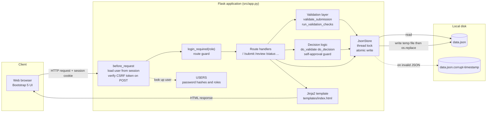
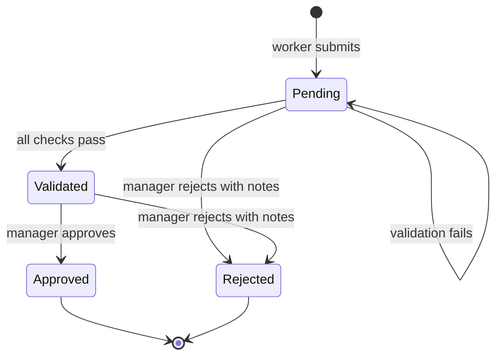
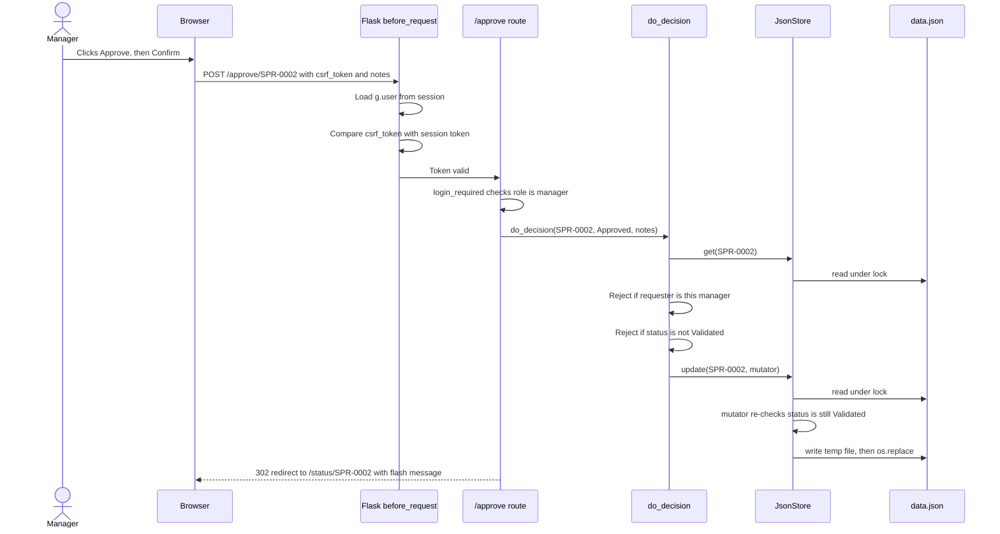
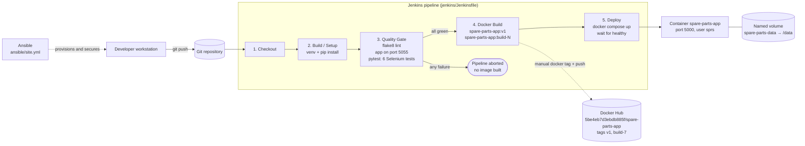

# Architecture: Spare Parts Request System (SPRS)

## 1. Software Requirements Specification (Summary)

### 1.1 Purpose

SPRS digitises the spare part requisition process of a maintenance department. It records requests from technicians, checks them against business rules, routes them to a manager for a decision, and keeps an auditable timeline of every action.

### 1.2 Users and roles

| Role | Account type | Permissions |
|---|---|---|
| Worker (maintenance technician) | `worker` | Submit requests, view own dashboard, track own requests |
| Manager (engineering or maintenance manager) | `manager` | View all requests, run validation, approve, reject |
| Anonymous | none | Sign-in page and `/health` only |

The MVP ships with five worker accounts and three manager accounts, defined in the `USERS` dictionary in `src/app.py`.

### 1.3 Functional requirements

| ID | Requirement |
|---|---|
| FR-01 | The system shall authenticate users by username and password and start a session on success |
| FR-02 | The system shall allow a worker to submit a request with part name, part number, quantity, urgency, asset ID and justification |
| FR-03 | The system shall reject a submission with any invalid field and report each invalid field individually |
| FR-04 | The system shall assign each request a unique sequential ID of the form `SPR-NNNN` |
| FR-05 | The system shall record the requester from the session, never from form input |
| FR-06 | The system shall let a manager run four validation checks on a Pending request and move it to Validated only if no check fails |
| FR-07 | The system shall let a manager approve a Validated request |
| FR-08 | The system shall let a manager reject a Pending or Validated request, only with notes of at least 10 characters |
| FR-09 | The system shall refuse any decision by a manager on a request they raised |
| FR-10 | The system shall append a timestamped timeline event, with the actor's name, for every submission, validation attempt and decision |
| FR-11 | The system shall show a worker only their own requests, on the dashboard and on tracking pages |
| FR-12 | The system shall show a manager every request, with summary counters, search and filters |
| FR-13 | The system shall expose an unauthenticated health check |

### 1.4 Non-functional requirements

| ID | Category | Requirement |
|---|---|---|
| NFR-01 | Deployment | Runs on a single machine with Python 3.10 or later, with no database server |
| NFR-02 | Persistence | All data is stored in one JSON file. Every write is atomic |
| NFR-03 | Resilience | A corrupt data file is preserved with a timestamped name and the app continues with an empty store |
| NFR-04 | Security | Passwords are stored only as salted PBKDF2-SHA256 hashes with 600,000 iterations |
| NFR-05 | Security | Every state-changing request is protected by a CSRF token |
| NFR-06 | Security | Session cookies are `HttpOnly` and `SameSite=Lax`, and expire after 8 hours |
| NFR-07 | Security | Role checks are enforced on the server for every protected route |
| NFR-08 | Usability | The interface is responsive down to phone width |
| NFR-09 | Testability | The app is built by a factory function that accepts a data file path and feature flags |
| NFR-10 | Configuration | Runtime settings are read from environment variables, so no code change is needed between environments |
| NFR-11 | Delivery | Every change passes a Jenkins quality gate (lint and browser tests) before a container image is built |
| NFR-12 | Security | The production container runs as an unprivileged user with a read-only root filesystem and no Linux capabilities |
| NFR-13 | Repeatability | Workspace setup is automated with an idempotent Ansible playbook, so repeated runs never drift the configuration |

## 2. System Architecture

### 2.1 Component diagram



### 2.2 Layer responsibilities

| Layer | Component | Responsibility |
|---|---|---|
| Presentation | `templates/index.html` | One Jinja2 template that renders six views (`login`, `dashboard`, `submit`, `review`, `status`, `error`) chosen by a `view` variable. Bootstrap 5 for layout, a small inline script for the decision confirmation modal |
| Request pipeline | `before_request` hook | Runs before every route. Loads the signed-in user from the session into `g.user`, creates a CSRF token for the session if missing, and rejects any POST whose `csrf_token` does not match |
| Access control | `login_required(role)` decorator | Redirects anonymous users to `/login`. Returns 403 when the signed-in role does not match the route's role |
| Routing | Route handlers in `create_app` | Parse input, call the business layer, set flash messages, and redirect or render |
| Business rules | `validate_submission`, `run_validation_checks`, `do_validate`, `do_decision` | Field validation, the four validation checks, lifecycle transitions and the self-approval guard |
| Identity | `USERS`, `authenticate` | Account lookup and password hash verification. Unknown usernames are checked against a dummy hash so they take the same time to reject as wrong passwords |
| Persistence | `JsonStore` | All reads and writes of `data.json`, serialised by a `threading.Lock`, with atomic replace and corrupt-file recovery. `update()` runs a mutator function inside the lock, and the mutator can cancel the write by returning `False` |

### 2.3 Request lifecycle



Approved and Rejected are final states. No route moves a request out of them.

### 2.4 Approval sequence



## 3. Data Model

### 3.1 File structure

All persistent data lives in a single file. Its default location is `src/data.json`, which can be changed with the `SPRS_DATA_FILE` environment variable. The file is created automatically on first run.

```json
{
  "next_id": 3,
  "requests": [
    {
      "id": "SPR-0002",
      "part_name": "Hydraulic Pump Mechanical Seal",
      "part_number": "PMP-SEAL-22",
      "quantity": 2,
      "urgency": "Critical",
      "asset_id": "HYD-PRESS-02",
      "requester": "Sneha Kulkarni",
      "requester_username": "sneha",
      "justification": "Main press seal leaking heavily, line stopped. Need replacement before next shift starts.",
      "status": "Approved",
      "created_at": "2026-11-02 08:10:25",
      "updated_at": "2026-11-02 08:11:02",
      "reviewer": "Vikram Desai",
      "reviewer_username": "vikram",
      "reviewer_notes": "Urgent, issue 2 seals from main stores.",
      "decided_at": "2026-11-02 08:11:02",
      "validation": {
        "passed": true,
        "checked_at": "2026-11-02 08:10:27",
        "checked_by": "Anita Rao",
        "checks": [
          {"name": "Field integrity", "result": "PASS", "detail": "All mandatory fields are present and well-formed."},
          {"name": "Duplicate check", "result": "PASS", "detail": "No open duplicate for this part/asset combination."},
          {"name": "Critical justification", "result": "PASS", "detail": "Justification meets critical-request threshold."},
          {"name": "Bulk quantity", "result": "PASS", "detail": "Quantity is within the expected range for the urgency."}
        ]
      },
      "timeline": [
        {"status": "Pending", "actor": "Sneha Kulkarni", "note": "Request submitted.", "timestamp": "2026-11-02 08:10:25"},
        {"status": "Validated", "actor": "Anita Rao", "note": "All validation checks passed.", "timestamp": "2026-11-02 08:10:27"},
        {"status": "Approved", "actor": "Vikram Desai", "note": "Urgent, issue 2 seals from main stores.", "timestamp": "2026-11-02 08:11:02"}
      ]
    }
  ]
}
```

### 3.2 Top-level attributes

| Attribute | Type | Description |
|---|---|---|
| `next_id` | integer | The number used for the next request ID. Incremented on every successful submission and never reused, even if requests are removed by hand |
| `requests` | array of Request | Every request ever submitted, in submission order |

### 3.3 Request object

| Attribute | Type | Set when | Rules and notes |
|---|---|---|---|
| `id` | string | Submission | `SPR-` followed by `next_id` padded to four digits, for example `SPR-0042` |
| `part_name` | string | Submission | 3 to 100 characters, surrounding whitespace removed |
| `part_number` | string | Submission | Uppercased. Pattern `^[A-Z0-9][A-Z0-9\-./]{2,29}$`, so 3 to 30 characters starting with a letter or digit |
| `quantity` | integer | Submission | Whole number from 1 to 10000 |
| `urgency` | string | Submission | One of `Low`, `Medium`, `High`, `Critical` |
| `asset_id` | string | Submission | Uppercased. Pattern `^[A-Z0-9][A-Z0-9\-_]{1,19}$`, so 2 to 20 characters |
| `requester` | string | Submission | Display name of the signed-in worker, taken from the session |
| `requester_username` | string | Submission | Username of the signed-in worker. Used for ownership checks and the self-approval guard |
| `justification` | string | Submission | 20 to 1000 characters. At least 50 characters are needed for a Critical request to pass validation |
| `status` | string | Every transition | One of `Pending`, `Validated`, `Approved`, `Rejected` |
| `created_at` | string | Submission | Local server time, format `YYYY-MM-DD HH:MM:SS` |
| `updated_at` | string | Every write | Local server time of the last change to this record |
| `reviewer` | string or null | Decision | Display name of the deciding manager. `null` until decided |
| `reviewer_username` | string or null | Decision | Username of the deciding manager. `null` until decided |
| `reviewer_notes` | string or null | Decision | Manager's notes. Empty string allowed on approval, at least 10 characters required on rejection |
| `decided_at` | string or null | Decision | Local server time of the approval or rejection |
| `validation` | Validation or null | Each validation run | Result of the most recent validation run. `null` until validation is first run |
| `timeline` | array of Event | Every action | Append-only history of the request |

### 3.4 Validation object

| Attribute | Type | Description |
|---|---|---|
| `passed` | boolean | `true` when no check returned `FAIL` |
| `checked_at` | string | Local server time of the run |
| `checked_by` | string | Display name of the manager who ran it |
| `checks` | array of Check | One entry per check that ran |

**Check object**

| Attribute | Type | Description |
|---|---|---|
| `name` | string | `Field integrity`, `Duplicate check`, `Critical justification` or `Bulk quantity` |
| `result` | string | `PASS`, `WARN` or `FAIL`. Only `FAIL` blocks the request |
| `detail` | string | Human-readable reason shown on the review page |

**Validation rules**

| Check | FAIL when | WARN when | Runs for |
|---|---|---|---|
| Field integrity | Any stored field breaks a submission rule, for example after a manual edit of `data.json` | Never | Every request |
| Duplicate check | An **earlier** request (lower ID) with the same `part_number` and `asset_id` is still Pending or Validated | Never | Every request |
| Critical justification | Justification is shorter than 50 characters | Never | Critical requests only |
| Bulk quantity | Never | Quantity is above 100 and urgency is Low | Every request |

The duplicate check deliberately looks only at earlier requests. If it compared against every open request, the original request would also fail because of its own later duplicate, and neither could ever be approved.

### 3.5 Event object

| Attribute | Type | Description |
|---|---|---|
| `status` | string | The status the request had after this event. A failed validation records `Pending` |
| `actor` | string | Display name of the user who acted |
| `note` | string | `Request submitted.`, `All validation checks passed.`, `Validation failed: <check names>`, or the reviewer's notes on a decision (`No notes provided.` if an approval had none) |
| `timestamp` | string | Local server time, format `YYYY-MM-DD HH:MM:SS` |

### 3.6 User account (in code, not in `data.json`)

| Attribute | Type | Description |
|---|---|---|
| key | string | Lowercase username, for example `anita` |
| `name` | string | Display name written into requests and timelines |
| `role` | string | `worker` or `manager` |
| `password_hash` | string | Werkzeug hash in the format `pbkdf2:sha256:600000$<salt>$<digest>` |

## 4. API and Route Endpoints

All pages return HTML unless stated otherwise. "Redirect" means an HTTP 302 response, usually with a flash message shown on the next page. Every POST route requires a `csrf_token` form field that matches the session, otherwise the response is **400** before the route runs.

### 4.1 Authentication routes

| Method | Path | Access | Parameters | Response and action |
|---|---|---|---|---|
| GET | `/login` | Anyone | Query `next` (optional) | 200 sign-in page. If already signed in, redirect to `/` |
| POST | `/login` | Anyone | Form `username`, `password`, `next` (optional), `csrf_token` | Valid credentials: session cleared and restarted, redirect to `next` if it is a local path, otherwise to `/`. Invalid: **401** with the sign-in page and "Invalid username or password." |
| POST | `/login/demo` | Anyone, demo mode only | Form `username`, `next` (optional), `csrf_token` | Demo mode off: **404**. Username not in `DEMO_ACCOUNTS`: **400**. Otherwise starts a session for that account and redirects like `/login` |
| POST | `/logout` | Anyone | Form `csrf_token` | Clears the session, redirect to `/login`. GET returns **405** |

### 4.2 Application routes

| Method | Path | Access | Parameters | Response and action |
|---|---|---|---|---|
| GET | `/` | Signed in | Query `status` (`Pending`, `Validated`, `Approved`, `Rejected` or `Open`), `urgency` (`Low`, `Medium`, `High`, `Critical`), `q` (free-text search) | 200 dashboard. Workers see their own requests and four counters. Managers see all requests and six counters. Rows are sorted open first, then by urgency from Critical to Low, then by ID |
| GET | `/submit` | Worker | none | 200 submission form |
| POST | `/submit` | Worker | Form `part_name`, `part_number`, `quantity`, `urgency`, `asset_id`, `justification`, `csrf_token` | Valid: request saved as Pending, redirect to `/status/<new id>`. Invalid: **400** with the form, the entered values, and a message per invalid field. Any `requester` field sent is ignored |
| POST | `/validate/<request_id>` | Manager | Path `request_id`, form `csrf_token` | Runs the four checks on a Pending request. Moves it to Validated if no check fails. Records a timeline event either way. Redirect to `/review/<request_id>`. Unknown ID: **404** |
| GET | `/review/<request_id>` | Manager | Path `request_id` | 200 review page with details, validation results and the decision panel. Unknown ID: **404** |
| POST | `/review/<request_id>` | Manager | Form `action` (`validate`, `approve` or `reject`), `notes`, `csrf_token` | Single endpoint that performs the chosen action with the same rules as the dedicated routes. Successful approve or reject redirects to `/status/<request_id>`. Anything else redirects back to `/review/<request_id>` |
| POST | `/approve/<request_id>` | Manager | Form `notes` (optional), `csrf_token` | Approves a Validated request. Refused if the request is not Validated or was raised by this manager. Success redirects to `/status/<request_id>`, failure to `/review/<request_id>` |
| POST | `/reject/<request_id>` | Manager | Form `notes` (at least 10 characters), `csrf_token` | Rejects a Pending or Validated request. Refused if notes are too short, the request is closed, or it was raised by this manager. Redirects as for approve |
| GET | `/status/<request_id>` | Signed in | Path `request_id` | 200 tracking page with progress bar, summary and timeline. A worker requesting someone else's request gets **404**, the same response as a missing ID |
| GET | `/health` | Anyone | none | 200 JSON `{"status": "ok", "requests": <total count>}` |

### 4.3 Error responses

| Status | When it happens | What the user sees |
|---|---|---|
| 302 to `/login` | A protected page is opened without a session | Sign-in page with "Please sign in to continue." and the original page kept in `next` |
| 400 | CSRF token missing or wrong, or invalid demo account, or invalid submission | Error page "Your form session expired. Reload the page and try again.", or the form with field errors |
| 401 | Wrong username or password | Sign-in page with an error message |
| 403 | Signed-in role is not allowed on the route | Error page "This page is only available to managers." (or workers) |
| 404 | Unknown request ID, another worker's request, or demo route while demo mode is off | Error page with a not-found message |
| 405 | Wrong HTTP method, for example GET `/logout` or GET `/approve/<id>` | Error page "Method not allowed for this URL." |
| 500 | Unhandled server error | Error page "Internal server error." |

## 5. Configuration

| Environment variable | Default | Purpose |
|---|---|---|
| `SPRS_DATA_FILE` | `src/data.json` | Path of the JSON data file |
| `SPRS_SECRET_KEY` | `sprs-dev-secret-change-me` | Key that signs session cookies. Must be changed for any shared deployment |
| `SPRS_HOST` | `127.0.0.1` | Interface the development server listens on |
| `SPRS_PORT` | `5000` | Port the development server listens on |
| `SPRS_DEBUG` | `0` | Set to `1` for Flask debug mode with auto-reload. Never use on a shared network |
| `SPRS_DEMO_MODE` | `0` | Set to `1` to enable one-click demo sign-in. Same effect as `python src/app.py --demo` |

Command-line entry points:

| Command | Effect |
|---|---|
| `python src/app.py` | Start the server |
| `python src/app.py --demo` | Start the server with demo sign-in enabled |
| `python src/app.py hash-password` | Prompt for a password twice and print its hash for the `USERS` dictionary |

Inside the container image, these defaults are overridden: `SPRS_HOST=0.0.0.0`, `SPRS_PORT=5000` and `SPRS_DATA_FILE=/data/data.json`. Docker Compose refuses to start unless `SPRS_SECRET_KEY` is provided through `docker/.env`, so the public development key can never reach a deployed container.

## 6. Key Design Decisions

| Decision | Alternative considered | Reason |
|---|---|---|
| Single JSON file with atomic replace | SQLite | The constraints rule out a database server. The temporary file is written in the same folder as `data.json` and then swapped in with `os.replace`. On Linux and macOS this swap is atomic. On Windows it is a single replace operation on the same drive, which protects against a half-written file in practice, though Windows does not formally guarantee atomicity. No extra dependency is needed either way |
| Status re-checked inside the locked update | Check once before writing | Checking first and writing later leaves a gap in which another manager can decide. Testing showed two simultaneous decisions both succeeding. Repeating the check inside the same lock as the write closes the gap, so only the first decision is saved |
| Application factory `create_app()` | Module-level `app` only | Each test can create an isolated app with its own temporary data file and feature flags |
| Requester and reviewer taken from the session | Name typed into the form | A typed name can be anything. The session is signed by the server and cannot be forged without the secret key |
| 404 instead of 403 for another worker's request | 403 Forbidden | A 403 would confirm that the request ID exists, letting a worker probe other people's requests |
| One template rendering six views | One template per page | Shared navbar, styles and macros live in one place, and the project specification asked for a single dashboard template |
| Demo sign-in as a separate route, off by default | A bypass inside `/login` | A separate route can be switched off completely, so normal sign-in never contains a password bypass |

## 7. DevOps Architecture

SPRS is delivered through three automated layers. Jenkins verifies every change, Docker packages the verified code into a hardened image, and Ansible prepares and secures the workspace the code is developed in. Releases are published to Docker Hub as a manual step after a successful pipeline run.

### 7.1 Delivery flow



### 7.2 CI/CD pipeline (Jenkins)

The pipeline is a declarative `Jenkinsfile` stored in the repository, so the build process is versioned and reviewed like application code. It runs with a 30-minute timeout, never runs two builds at once (`disableConcurrentBuilds`), and keeps the last 20 builds.

| Stage | What it does | Fails the build when |
|---|---|---|
| **Checkout** | Pulls the commit that triggered the build and prints its hash, author and message | The repository cannot be reached |
| **Build / Setup** | Creates a fresh virtual environment in the workspace, installs `requirements.txt`, and runs `pip check` to catch conflicting dependencies | A package cannot be installed or dependencies conflict |
| **Quality Gate (Selenium Tests)** | Runs `flake8 --max-line-length=120` on `src` and `tests`. Starts SPRS in the background on port **5055** with a throw-away data file, waits until `/health` reports `ok`, then runs the Selenium suite with `pytest`. Publishes JUnit results and archives the server log and failure screenshots | Any lint warning, the app not becoming healthy within 30 seconds, or any failing test |
| **Docker Build** | Builds the image from `docker/Dockerfile` with two tags: `spare-parts-app:v1` and `spare-parts-app:build-<Jenkins build number>` | The image does not build |
| **Deploy** | Recreates the container with `docker compose up -d --no-build --force-recreate`, injecting the session secret from the Jenkins credential `sprs-secret-key`, and waits for Docker to report the container `healthy` | The container is not healthy within 90 seconds. Its last 100 log lines are printed |

**Why the tests use port 5055.** After the first deployment, the live container keeps port 5000 open. A test server on the same port would fail to start on every later build. A dedicated test port lets the quality gate run while the previous release keeps serving users.

**Why the stages are ordered this way.** The Docker Build stage only runs if the quality gate passes. A commit with a lint warning or a failing browser test therefore never produces an image, and the running release is never replaced by unverified code.

### 7.3 Automated test suite

`pytest` is the test runner for six end-to-end tests in `tests/selenium/test_spare_parts_ui.py`. They drive a real headless Chrome browser through the same pages a user would see.

| # | Test | What it proves |
|---|---|---|
| 1 | `test_homepage_requires_sign_in` | An anonymous visitor to `/` is redirected to the sign-in page |
| 2 | `test_homepage_loads_with_title_and_header` | After sign-in, the worker dashboard shows the correct title, brand, heading, user and role, and no manager navigation |
| 3 | `test_submit_request_redirects_with_success_flash` | Submitting the form redirects to `/status/SPR-NNNN` with a success message, a Pending status, and the requester locked to the signed-in worker |
| 4 | `test_new_request_appears_in_dashboard_table` | The new request appears in the dashboard table with every value correct, and a search by part number returns exactly that row |
| 5 | `test_invalid_submission_shows_field_error` | A quantity of zero is refused with the exact field error, and the other entered values are kept |
| 6 | `test_worker_cannot_open_manager_review_page` | A worker opening a manager review URL receives the 403 page and no Approve button |

Design points of the suite:

- **Two run modes.** When `SPRS_BASE_URL` is set, the tests target that server, which is how Jenkins runs them. Otherwise the suite starts its own copy of the app on a free port with a temporary data file, so a developer's real `data.json` is never touched.
- **Unique test data.** Each run generates a random suffix for part numbers and asset IDs, so repeated runs never trip the duplicate check or collide with earlier data.
- **Failure evidence.** `tests/selenium/conftest.py` saves a screenshot and the page HTML for every failing test, which Jenkins archives with the build.
- **Driver resolution.** ChromeDriver comes from `CHROMEDRIVER_PATH` if set, then `webdriver-manager`, then Selenium Manager.

### 7.4 Containerization (Docker)

The image is built from the project root with `docker build -f docker/Dockerfile -t spare-parts-app:v1 .` in two stages.

| Stage | Base | Contents | Purpose |
|---|---|---|---|
| `builder` | `python:3.10-slim` | A virtual environment in `/opt/venv` with `requirements.txt` and Gunicorn installed | Keeps pip, build caches and the requirements file out of the final image |
| `runtime` | `python:3.10-slim` | Only `/opt/venv` copied from the builder, and the `src/` folder | The image that actually runs |

**Security isolation.**

| Measure | Where | Effect |
|---|---|---|
| Non-root system user `sprs` (UID and GID 10001, no home, no login shell) | Dockerfile | A compromised app has no root privileges inside the container |
| Application code owned by root, `/data` owned by `sprs` with mode `0750` | Dockerfile | The running app can write its data but cannot modify its own code |
| `read_only: true` with a `tmpfs` at `/tmp` | Compose | The whole root filesystem is read-only. Only `/data` and `/tmp` are writable |
| `cap_drop: ALL` and `no-new-privileges` | Compose | No Linux capabilities, and no way to gain privileges through setuid binaries |
| `.dockerignore` | Project root | `.git`, virtual environments, `data.json`, `docker/.env`, docs and tests never enter the build context |
| `SPRS_SECRET_KEY` required by Compose | Compose | The container cannot start with the public development key |

**Process model.** Gunicorn runs **one worker process with eight threads**. `JsonStore` protects `data.json` with a `threading.Lock`, which is shared by threads but not by processes. Several worker processes would each hold a separate lock and could overwrite each other's changes, which is the lost-update problem fixed in the application. One worker keeps that guarantee intact.

**Persistence.** A named volume, `spare-parts-data`, is mounted at `/data`. It survives container restarts, image rebuilds, redeployments and `docker compose down`. Only `docker compose down -v` deletes it. The volume holds the whole directory rather than the single file, because the atomic write creates a temporary file next to `data.json` and renames it over the original, and a rename onto a single mounted file fails.

**Health check.** Every 10 seconds Docker calls `/health` inside the container and marks it `healthy` only when the response is `{"status": "ok"}`. The Jenkins Deploy stage waits for this state before reporting success.

### 7.5 Image registry and release (Docker Hub)

Verified images are published to the Docker Hub namespace **`5be4eb7d3ebdb885f`** as a manual release step, run after a successful Jenkins build.

| Published tag | Meaning |
|---|---|
| `5be4eb7d3ebdb885f/spare-parts-app:v1` | The current release line. Moves to the newest verified build of version 1 |
| `5be4eb7d3ebdb885f/spare-parts-app:build-7` | An immutable snapshot of Jenkins build #7. Never overwritten, so any deployment can be traced to the exact pipeline run and commit that produced it |

Release commands, run on the Jenkins host after a green build:

```bash
docker login -u 5be4eb7d3ebdb885f
docker tag spare-parts-app:v1      5be4eb7d3ebdb885f/spare-parts-app:v1
docker tag spare-parts-app:build-7 5be4eb7d3ebdb885f/spare-parts-app:build-7
docker push 5be4eb7d3ebdb885f/spare-parts-app:v1
docker push 5be4eb7d3ebdb885f/spare-parts-app:build-7
```

Anyone can then run the released version without the source code:

```bash
docker pull 5be4eb7d3ebdb885f/spare-parts-app:build-7
docker run -d -p 5000:5000 -e SPRS_SECRET_KEY=<random value> \
  -v spare-parts-data:/data 5be4eb7d3ebdb885f/spare-parts-app:build-7
```

Publishing is manual so that pushing to a public registry stays a deliberate human decision and no registry password is stored in Jenkins. Automating it with a Jenkins credential is listed on the roadmap in `final_report.md`.

### 7.6 Configuration management (Ansible)

| File | Role |
|---|---|
| `ansible/hosts` | Inventory with a single host, `localhost`, using `ansible_connection=local`, so no SSH is needed. It uses the same Python interpreter that runs Ansible |
| `ansible/site.yml` | Playbook that provisions, checks and secures the project workspace. Run with `ansible-playbook -i ansible/hosts ansible/site.yml` from the project root. It needs no root access and touches only files inside the project |

**What the playbook does, in order.**

| Group | Tasks |
|---|---|
| Workspace provisioning | Ensures `src`, `src/templates`, `docker`, `docs`, `jenkins`, `ansible`, `tests` and `tests/selenium` exist with mode `0755`. Fails with a list of missing files if any of the seven required project files is absent |
| Prerequisite checks | Fails unless Python 3 is at least version 3.10 (the development machine runs Python 3.12). Fails unless the `venv` module and `pip` are available, and prints the install command if not |
| Optional toolchain checks | Reports whether Git, Docker and Docker Compose v2 are installed. Missing tools are reported but do not fail the run, because they are only needed for CI and containers |
| File permission security | Sets every source file (Python, HTML, Markdown, YAML, text, `Dockerfile`, `Jenkinsfile`, `hosts`) to `0644`. Sets `src/data.json`, any `data.json.corrupt-*` backups, and `docker/.env` to `0600` |
| `.gitignore` management | Ensures ten entries exist in `.gitignore`, creating the file if needed: virtual environments, caches, `src/data.json`, corrupt backups, temporary data files, `docker/.env`, `ci-data/` and `tests/selenium/artifacts/` |
| Summary | Prints the project root, Python version, number of files checked and secured, and the status of each optional tool |

**Permission model.**

| Mode | Applied to | Reason |
|---|---|---|
| `0755` | Project directories | Everyone can enter and list them, only the owner can add or remove files |
| `0644` | Source code and documentation | Readable by everyone, writable only by the owner, so another local user cannot alter the code |
| `0600` | `data.json`, corrupt backups, `docker/.env` | These hold staff names, request history and the session signing secret, so only the owner can read them |

**Idempotency.** Every task uses a declarative Ansible module (`file`, `lineinfile`, `stat`, `find`, `assert`) that first compares the current state with the desired state and changes something only when they differ. Read-only checks such as `python3 --version` are marked `changed_when: false`. The result is that the playbook describes a target state, not a list of actions, and running it again on a correct workspace does nothing.

**Idempotency evidence.**

| Run | Workspace state | `PLAY RECAP` result |
|---|---|---|
| First run | Freshly cloned workspace, with drift from the target state | `changed=1` to `changed=2`, `failed=0`, depending on the starting state |
| Second run | Same workspace, immediately after | `changed=0`, `failed=0` |

Typical causes of a change on the first run are the `.gitignore` task adding missing entries, a source file that was group or world writable being reset to `0644`, or `data.json` being tightened to `0600`. Ansible counts changed **tasks**, not items, so adding all ten `.gitignore` lines counts as one change. A second run reporting `changed=0` proves that the workspace already matches the declared state, and that running the playbook again, for example after a teammate changes permissions by accident, only ever corrects drift and never causes it.

### 7.7 DevOps design decisions

| Decision | Alternative considered | Reason |
|---|---|---|
| Separate test port 5055 in CI | Test on port 5000 | Port 5000 is held by the deployed container after the first release, so tests on it would fail on every later build |
| Gunicorn with one worker and eight threads | Several worker processes | The JSON store's lock only works within one process. More processes would reintroduce lost updates |
| Volume mounted on the `/data` directory | Bind-mounting `data.json` alone | Atomic writes rename a temporary file over `data.json`, which fails when `data.json` is itself a mount point |
| Two image tags per build | A single `latest` tag | `v1` gives users a stable name, while `build-N` gives an immutable, traceable snapshot for rollback |
| Manual Docker Hub push | Push from the pipeline | Publishing publicly stays a deliberate decision, and no registry credential is stored in Jenkins |
| Ansible on `localhost` with a local connection | Shell setup script | Declarative modules give idempotency and a clear changed or ok report for every task, which a shell script does not |
| Lint before tests in the quality gate | Tests only | Lint takes seconds, so obvious problems fail the build before the slower browser tests start |
